# Diagrama de Patrón de Diseño — Sistema Informático Buen Vivir

> Arquitectura: **Microservicios Go · MVC · Angular PWA · Google Cloud API Gateway · Pub/Sub**

```mermaid
flowchart TD
    %% ─────────────────────────────────────────
    %% CLIENTES
    %% ─────────────────────────────────────────
    subgraph CLIENTS["👤 Clientes"]
        BROWSER["Angular PWA\n(Browser / PWA)"]
        MOBILE["Mobile Client\n(Navegador móvil)"]
    end

    %% ─────────────────────────────────────────
    %% FRONTEND ANGULAR (View Layer — MVC)
    %% ─────────────────────────────────────────
    subgraph FRONTEND["🖥️ Frontend — Angular PWA (View)"]
        direction TB
        COMPONENT["Components\n(.component.ts / .html)"]
        ANGULAR_SERVICE["Angular Services\n(HttpClient · JSON)"]
        GUARD["Route Guards\n(AuthGuard)"]
        INTERCEPTOR["HTTP Interceptors\n(JWT Bearer header)"]
        STORE["State Store\n(NgRx / Signals)"]
        SW["Service Worker\n(ngsw-config.json · PWA)"]

        COMPONENT --> ANGULAR_SERVICE
        COMPONENT --> GUARD
        ANGULAR_SERVICE --> INTERCEPTOR
        ANGULAR_SERVICE --> STORE
    end

    BROWSER --> COMPONENT
    MOBILE --> COMPONENT

    %% ─────────────────────────────────────────
    %% API GATEWAY (Google Cloud)
    %% ─────────────────────────────────────────
    subgraph GW["☁️ Google Cloud API Gateway"]
        direction TB
        GATEWAY["API Gateway\n(openapi.yaml / Swagger 2.0)\n• JWT validation\n• Rate limiting\n• Path routing\n• HTTPS only · JSON"]
    end

    INTERCEPTOR -->|"HTTPS · JSON\nBearer JWT"| GATEWAY

    %% ─────────────────────────────────────────
    %% MICROSERVICIOS (Controller — MVC)
    %% ─────────────────────────────────────────
    subgraph MS["⚙️ Microservicios — Go (Cloud Run)"]
        direction TB

        subgraph AUTH["🔐 Auth Service :8081"]
            direction TB
            AUTH_ROUTE["Routes\n(internal/routes)"]
            AUTH_CTRL["Controller\nAuthController\n(JSON decode/encode)"]
            AUTH_SVC["Service\nAuthService\n(JWT · bcrypt)"]
            AUTH_REPO["Repository\nUserRepository\n(GORM · SQL)"]
            AUTH_MODEL["Model\nUser / LoginRequest\nLoginResponse\n(json tags)"]
            AUTH_ROUTE --> AUTH_CTRL --> AUTH_SVC --> AUTH_REPO
            AUTH_SVC --> AUTH_MODEL
            AUTH_REPO --> AUTH_MODEL
        end

        subgraph CAMPAIGNS["📢 Campaigns Service :8082"]
            direction TB
            CAM_CTRL["Controller\n(JSON)"]
            CAM_SVC["Service"]
            CAM_REPO["Repository\n(GORM · SQL)"]
            CAM_MODEL["Model\nCampaign\n(json tags)"]
            CAM_CTRL --> CAM_SVC --> CAM_REPO --> CAM_MODEL
        end

        subgraph DASHBOARD["📊 Dashboard Service :8083"]
            direction TB
            DASH_CTRL["Controller\n(JSON)"]
            DASH_SVC["Service"]
            DASH_REPO["Repository\n(GORM · SQL)"]
            DASH_MODEL["Model\nMetrics / KPIs\n(json tags)"]
            DASH_CTRL --> DASH_SVC --> DASH_REPO --> DASH_MODEL
        end

        subgraph EDUCATION["🎓 Education Service :8084"]
            direction TB
            EDU_CTRL["Controller\n(JSON)"]
            EDU_SVC["Service"]
            EDU_REPO["Repository\n(GORM · NoSQL)"]
            EDU_MODEL["Model\nCourse / Enrollment\n(json tags)"]
            EDU_CTRL --> EDU_SVC --> EDU_REPO --> EDU_MODEL
        end

        subgraph HUMANPROM["🤝 Human Promotion Service :8085"]
            direction TB
            HP_CTRL["Controller\n(JSON)"]
            HP_SVC["Service"]
            HP_REPO["Repository\n(GORM · NoSQL)"]
            HP_MODEL["Model\nBenefit / Person\n(json tags)"]
            HP_CTRL --> HP_SVC --> HP_REPO --> HP_MODEL
        end

        subgraph LABORINT["💼 Labor Integration Service :8086"]
            direction TB
            LI_CTRL["Controller\n(JSON)"]
            LI_SVC["Service"]
            LI_REPO["Repository\n(GORM · NoSQL)"]
            LI_MODEL["Model\nJob / Application\n(json tags)"]
            LI_CTRL --> LI_SVC --> LI_REPO --> LI_MODEL
        end

        subgraph NOTIF["🔔 Notifications Service :8087"]
            direction TB
            NOTIF_ROUTE["Routes\n(internal/routes)"]
            NOTIF_CTRL["Controller\n(JSON)"]
            NOTIF_SVC["Service\nNotificationService"]
            NOTIF_REPO["Repository\nNotificationRepository\n(GORM · SQL)"]
            NOTIF_MODEL["Model\nNotification\n(json tags)"]
            PUBSUB_SUB["Pub/Sub Subscriber\n(google-cloud-go/pubsub)"]
            NOTIF_ROUTE --> NOTIF_CTRL --> NOTIF_SVC --> NOTIF_REPO --> NOTIF_MODEL
            PUBSUB_SUB --> NOTIF_SVC
        end

        subgraph RXRESUME["📄 RxResume Service :8088"]
            direction TB
            RX_CTRL["Controller\n(JSON)"]
            RX_SVC["Service"]
            RX_REPO["Repository\n(GORM · PostgreSQL)"]
            RX_MODEL["Model\nResume / Section\n(json tags)"]
            RX_CTRL --> RX_SVC --> RX_REPO --> RX_MODEL
        end
    end

    GATEWAY -->|"POST /api/v1/auth\nJSON"| AUTH_ROUTE
    GATEWAY -->|"GET /api/v1/campaigns\nJSON"| CAM_CTRL
    GATEWAY -->|"GET /api/v1/dashboard\nJSON"| DASH_CTRL
    GATEWAY -->|"GET /api/v1/education\nJSON"| EDU_CTRL
    GATEWAY -->|"GET /api/v1/human-promotion\nJSON"| HP_CTRL
    GATEWAY -->|"GET /api/v1/labor-integration\nJSON"| LI_CTRL
    GATEWAY -->|"GET /api/v1/notifications\nJSON"| NOTIF_ROUTE
    GATEWAY -->|"GET /api/v1/rxresume\nJSON"| RX_CTRL

    %% ─────────────────────────────────────────
    %% GOOGLE PUB/SUB (Event Bus)
    %% ─────────────────────────────────────────
    subgraph PUBSUB_LAYER["📨 Google Cloud Pub/Sub"]
        direction LR
        TOPIC_NOTIF["Topic: notifications"]
        TOPIC_AUDIT["Topic: audit-events"]
        TOPIC_CAMPAIGN["Topic: campaign-events"]
        SUB_NOTIF["Subscription: notif-sub"]
        SUB_AUDIT["Subscription: audit-sub"]
        SUB_CAMPAIGN["Subscription: campaign-sub"]
        TOPIC_NOTIF --> SUB_NOTIF
        TOPIC_AUDIT --> SUB_AUDIT
        TOPIC_CAMPAIGN --> SUB_CAMPAIGN
    end

    %% Publishers → Topics
    AUTH_SVC -->|"Publish · JSON msg\nuser.created / login"| TOPIC_AUDIT
    CAMPAIGNS -->|"Publish · JSON msg\ncampaign.published"| TOPIC_CAMPAIGN
    HUMANPROM -->|"Publish · JSON msg\nbenefit.assigned"| TOPIC_NOTIF
    LABORINT -->|"Publish · JSON msg\njob.matched"| TOPIC_NOTIF
    EDUCATION -->|"Publish · JSON msg\nenrollment.confirmed"| TOPIC_NOTIF

    %% Subscriptions → Consumers
    SUB_NOTIF --> PUBSUB_SUB
    SUB_CAMPAIGN --> CAM_SVC
    SUB_AUDIT -->|"Structured log"| CLOUD_LOGGING

    %% ─────────────────────────────────────────
    %% BASES DE DATOS
    %% ─────────────────────────────────────────
    subgraph DBS["🗄️ Bases de Datos (GCP)"]
        direction LR
        DB_AUTH[("Cloud SQL\nPostgreSQL\nDB: usuarios\nORM: GORM")]
        DB_CAMPAIGNS[("Cloud SQL\nPostgreSQL\nDB: campaignas\nORM: GORM")]
        DB_NOTIF[("Cloud SQL\nPostgreSQL\nDB: notifications\nORM: GORM")]
        DB_EDU[("Firestore\nNoSQL Documental\nDB: education")]
        DB_HP[("Firestore\nNoSQL Documental\nDB: human-promotion")]
        DB_LI[("Firestore\nNoSQL Documental\nDB: labor-integration")]
        DB_RX[("Cloud SQL\nPostgreSQL\nDB: rxresume\nORM: GORM")]
        GCS[("Cloud Storage\nGCS Buckets\nArchivos / Docs")]
    end

    AUTH_REPO --> DB_AUTH
    CAM_REPO --> DB_CAMPAIGNS
    NOTIF_REPO --> DB_NOTIF
    EDU_REPO --> DB_EDU
    HP_REPO --> DB_HP
    LI_REPO --> DB_LI
    RX_REPO --> DB_RX
    RXRESUME -->|"Upload PDF"| GCS
    EDUCATION -->|"Upload material"| GCS

    %% ─────────────────────────────────────────
    %% SERVICIOS EXTERNOS
    %% ─────────────────────────────────────────
    subgraph EXTERNAL["🌐 Servicios Externos"]
        GMAPS["Google Maps API\n(geolocalización)"]
        CONCORDIA["Concordia API\n(beneficios sociales)"]
        CLOUD_LOGGING["Google Cloud Logging\n(structured JSON logs)"]
        CLOUD_MONITORING["Cloud Monitoring\n(métricas / alertas)"]
    end

    CAMPAIGNS -->|"REST · JSON"| GMAPS
    HUMANPROM -->|"REST · JSON"| CONCORDIA
    DASHBOARD -->|"métricas"| CLOUD_MONITORING
    AUTH_SVC --> CLOUD_LOGGING
    NOTIF_SVC --> CLOUD_LOGGING

    %% ─────────────────────────────────────────
    %% ESTILOS
    %% ─────────────────────────────────────────
    classDef model fill:#2d6a4f,color:#fff,stroke:#1b4332
    classDef controller fill:#1d3557,color:#fff,stroke:#0a1628
    classDef service fill:#457b9d,color:#fff,stroke:#1d3557
    classDef repo fill:#6d4c41,color:#fff,stroke:#3e2723
    classDef route fill:#37474f,color:#fff,stroke:#102027
    classDef db fill:#4a148c,color:#fff,stroke:#1a0033
    classDef pubsub fill:#e65100,color:#fff,stroke:#bf360c
    classDef gateway fill:#006064,color:#fff,stroke:#003333
    classDef external fill:#880e4f,color:#fff,stroke:#4a0027
    classDef frontend fill:#1565c0,color:#fff,stroke:#0d3c7a

    class AUTH_MODEL,CAM_MODEL,DASH_MODEL,EDU_MODEL,HP_MODEL,LI_MODEL,NOTIF_MODEL,RX_MODEL model
    class AUTH_CTRL,CAM_CTRL,DASH_CTRL,EDU_CTRL,HP_CTRL,LI_CTRL,NOTIF_CTRL,RX_CTRL controller
    class AUTH_SVC,CAM_SVC,DASH_SVC,EDU_SVC,HP_SVC,LI_SVC,NOTIF_SVC,RX_SVC service
    class AUTH_REPO,CAM_REPO,DASH_REPO,EDU_REPO,HP_REPO,LI_REPO,NOTIF_REPO,RX_REPO repo
    class AUTH_ROUTE,NOTIF_ROUTE route
    class DB_AUTH,DB_CAMPAIGNS,DB_NOTIF,DB_EDU,DB_HP,DB_LI,DB_RX,GCS db
    class TOPIC_NOTIF,TOPIC_AUDIT,TOPIC_CAMPAIGN,SUB_NOTIF,SUB_AUDIT,SUB_CAMPAIGN,PUBSUB_SUB pubsub
    class GATEWAY gateway
    class GMAPS,CONCORDIA,CLOUD_LOGGING,CLOUD_MONITORING external
    class COMPONENT,ANGULAR_SERVICE,GUARD,INTERCEPTOR,STORE,SW frontend
```

---

## Leyenda de Colores

| Color | Capa |
|-------|------|
| 🟢 Verde oscuro | **Model** — structs Go con `json` tags / DTOs |
| 🔵 Azul oscuro | **Controller** — HTTP Handlers (JSON decode/encode) |
| 🔵 Azul medio | **Service** — Lógica de negocio |
| 🟤 Marrón | **Repository** — Persistencia (GORM · SQL / Firestore) |
| ⚫ Gris pizarra | **Routes** — Definición de endpoints |
| 🟣 Violeta | **Databases** — Cloud SQL PostgreSQL / Firestore / GCS |
| 🟠 Naranja | **Google Pub/Sub** — Topics · Subscriptions · Subscribers |
| 🩵 Teal | **API Gateway** — Google Cloud API Gateway (OpenAPI 2.0) |
| 🔴 Rosa oscuro | **Servicios Externos** — Google Maps, Concordia, Logging |
| 🔵 Azul brillante | **Frontend** — Angular PWA (Components, Services, Guards) |

---

## Patrones de Diseño Identificados

| Patrón | Dónde aplica |
|--------|-------------|
| **MVC** | Todos los microservicios Go: `models/` → `controllers/` → `views (JSON response)` |
| **Repository Pattern** | `internal/repositories/` — abstrae el acceso a datos (GORM interface) |
| **Service Layer** | `internal/services/` — lógica desacoplada del transporte HTTP |
| **Dependency Injection** | `NewAuthService(repo, secret)` — inyección manual de dependencias en Go |
| **DTO (Data Transfer Object)** | `LoginRequest`, `LoginResponse`, `Notification` — structs con `json:` tags |
| **Observer / Pub-Sub** | Google Cloud Pub/Sub — microservicios publican eventos, Notifications los consume |
| **Gateway Pattern** | Google Cloud API Gateway — punto de entrada único con JWT + routing |
| **Interceptor Pattern** | Angular HTTP Interceptor — añade `Authorization: Bearer <JWT>` automáticamente |
| **Guard Pattern** | Angular Route Guards — protección de rutas autenticadas |
| **PWA / Service Worker** | `ngsw-config.json` — cache offline de assets |
