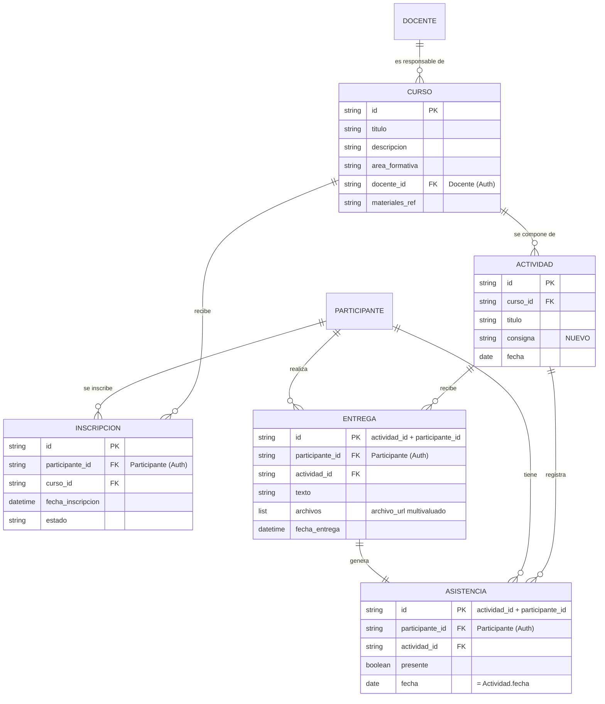

# DER — Servicio Educación (actualización: entidad Entrega)

Actualización del DER de Buen Vivir App para el **Servicio Educación | DB
Educación — NoSQL Documental**. Complementa a `referencias/DER Buen Vivir-App.jpg` y a
`referencias/Expliacion der buen vivir app.pdf` (en `docs/`). Esos dos archivos son la
versión anterior; este documento describe **solo lo que cambia** en Educación y
está redactado con el mismo formato que el PDF, para poder copiarlo ahí.

Cambios respecto de la versión anterior:

1. **Actividad** suma el campo `consigna`.
2. Se agrega la entidad **Entrega** (tabla pasarela N:M entre Participante y
   Actividad).
3. **Asistencia** deja de cargarse a mano: cada registro lo genera una Entrega,
   y su `fecha` es la fecha de la actividad.

Las demás entidades de Educación (Curso, Inscripcion, Habilidad,
Participante_Habilidad, Curso_Habilidad, ContenidoDocente, DescargaBiblioteca,
Comentario, AsistenciaGeneral) no cambian.

---

## Diagrama (solo la parte afectada)

Línea sólida = relación dentro del mismo microservicio. Las referencias a
Participante y Docente son lógicas (viven en el Servicio Autenticación, sin FK
física), igual que en el DER original.

---

## Explicación de las relaciones (Educación)

Se mantienen las relaciones del PDF y se agregan o ajustan estas:

- **Curso 1:N Actividad** → cada curso se compone de varias actividades. Cada
  actividad tiene un título, una **consigna** (qué tiene que hacer y entregar el
  participante) y una fecha programada. *(Sin cambios en la cardinalidad; se
  suma `consigna`.)*
- **Participante N:M Actividad, resuelta con Entrega** → un participante puede
  entregar muchas actividades y una actividad recibe entregas de muchos
  participantes. Como máximo hay **una entrega por participante y actividad**,
  y una vez hecha no se puede modificar ni anular. Solo puede entregar un
  participante con una Inscripcion activa en el curso de la actividad.
  - **Actividad 1:N Entrega**: una actividad recibe, como máximo, una entrega
    por cada participante inscripto.
  - **Participante 1:N Entrega**: referencia lógica al Participante del
    Servicio Autenticación (sin FK física entre bases).
- **Participante N:M Actividad, resuelta con Asistencia** → sigue registrando la
  presencia de cada participante en cada actividad y de ahí se calcula el
  progreso del curso. **Cambio:** ya no se carga a mano. La genera la entrega.
- **Entrega 1:1 Asistencia (derivada)** → Entrega y Asistencia comparten la
  misma clave (`actividad_id`, `participante_id`), y en Firestore también el
  mismo id de documento. Al entregar, en **una sola transacción** se crean la
  Entrega y la Asistencia (`presente = true`, `fecha = Actividad.fecha`): o se
  guardan las dos o ninguna. No es una FK entre tablas sino una regla de
  consistencia. Toda Asistencia de un curso tiene su Entrega, y un participante
  sin Asistencia en una actividad figura como *ausente / sin entregar*.

### Reglas que se desprenden

- **Asistencia por curso (HU-19)**: las actividades del curso son exactamente
  las columnas del registro de asistencia, que se completa solo a partir de las
  entregas. Las pantallas de asistencia por curso quedan como consulta del
  historial.
- **Progreso (HU-20)** = actividades entregadas / total de actividades del
  curso. Se actualiza automáticamente con cada entrega, porque cada entrega es
  una Asistencia con `presente = true`.
- **Fecha de la asistencia**: siempre es la fecha de la actividad, no la del
  momento de la entrega. Si una actividad se reprograma, sus asistencias se
  mueven con ella en la misma transacción.
- **Baja de una actividad**: se borran también sus entregas y asistencias, y
  sus archivos del bucket, para que el progreso no cuente registros de una
  actividad que ya no existe. La interfaz pide confirmación explícita.
- **AsistenciaGeneral (HU-19bis)** no cambia: sigue siendo la asistencia diaria
  del centro, independiente de cursos, actividades y entregas.

---

## Descripción detallada de tablas (cambios)

### Actividad

| Campo | Tipo / Referencia | Descripción |
|---|---|---|
| id | PK | Identificador de la actividad |
| curso_id | FK → Curso | Curso al que pertenece |
| titulo | string | Título de la actividad |
| **consigna** | **string** | **Qué tiene que hacer y entregar el participante (nuevo)** |
| fecha | date | Fecha programada. Es también la fecha de las asistencias que generan sus entregas |

### Entrega *(tabla pasarela / N:M)* — nueva

| Campo | Tipo / Referencia | Descripción |
|---|---|---|
| id | PK | Identificador de la entrega. Se forma con `actividad_id` + `participante_id`, lo que garantiza una única entrega por participante y actividad |
| participante_id | FK → Participante (Auth) | Quién entrega |
| actividad_id | FK → Actividad | Qué actividad entrega |
| texto | string | Respuesta escrita (opcional) |
| archivo_url | string (multivaluado) | Adjuntos de la entrega (0 a 5). Por cada uno se guarda nombre, tipo, tamaño y la ubicación del archivo en Google Cloud Storage |
| fecha_entrega | datetime | Cuándo se entregó |

### Asistencia *(tabla pasarela / N:M)* — cambia su origen

| Campo | Tipo / Referencia | Descripción |
|---|---|---|
| id | PK | Identificador del registro. Mismo valor que la Entrega que lo generó |
| participante_id | FK → Participante (Auth) | Quién asistió |
| actividad_id | FK → Actividad | A qué actividad |
| presente | boolean | Presente / ausente. Al generarse por una entrega es siempre `true` |
| fecha | date | **Fecha de la actividad** (no la de la entrega) |

---

## Implementación en Firestore

| Colección | Id del documento | Campos |
|---|---|---|
| `actividades` | autogenerado | `curso_id`, `titulo`, `consigna`, `fecha` (medianoche UTC del día de la actividad), `created_at` |
| `entregas` | `{actividadId}_{participanteId}` | `participante_id`, `actividad_id`, `texto`, `archivos[]` (`nombre`, `tipo`, `tamano`, `ruta`), `fecha_entrega` |
| `asistencias` | `{actividadId}_{participanteId}` | `participante_id`, `actividad_id`, `presente`, `fecha` |

- **Unicidad de la entrega:** el documento de `entregas` se crea con `Create`,
  que falla si el id ya existe. Así la unicidad no depende de un chequeo previo
  que dos requests simultáneos podrían saltearse, y la entrega no se puede
  pisar.
- **Consistencia Entrega ↔ Asistencia:** ambos documentos se escriben en la
  misma transacción de Firestore.

### Dónde quedan los archivos adjuntos

Los archivos **no se guardan en Firestore ni en Contentful**. Van a un bucket
privado de **Google Cloud Storage**, del mismo proyecto de GCP que Firestore.
Cada tecnología guarda una parte:

| Dónde | Qué guarda | Quién lo ve |
|---|---|---|
| Contentful | El contenido publicado del catálogo: cursos, áreas formativas y materiales del docente | Público (CDN) |
| Firestore | Los datos operativos del curso: actividades, inscripciones, entregas (texto y metadatos de los adjuntos) y asistencias | Solo a través de education-service |
| Cloud Storage (bucket de entregas) | El binario de cada adjunto, en `entregas/{actividadId}/{participanteId}/...` | Solo a través de education-service |

- En la base de datos (Firestore) queda el **metadato** del archivo, incluida su
  `ruta` dentro del bucket. El archivo en sí queda en el bucket.
- El bucket **no es público** y los archivos no tienen URL propia. Para
  descargar un adjunto, el frontend llama a
  `GET /api/entregas/{id}/archivos/{indice}`. education-service valida quién
  pide (administrador o voluntario, el docente responsable del curso o el mismo
  participante), lee el archivo del bucket con la misma cuenta de servicio que
  usa para Firestore y lo devuelve.
- Por eso las entregas **no pasan por Contentful**. Contentful expone sus
  archivos en una CDN pública, y las entregas son datos personales de cada
  participante.

## ContenidoDocente y DescargaBiblioteca (2026-10-22)

Implementan HU-23 (contenido de docentes externos con moderación) y HU-25
(biblioteca pública con registro de descargas). Viven en Firestore, en las
colecciones `contenidos_docentes` y `descargas_biblioteca`.

**ContenidoDocente**

| Campo | Tipo | Descripción |
| --- | --- | --- |
| id | PK | Identificador del contenido |
| docente_id | FK Docente (Auth) | Usuario que lo subió (el `sub` del token) |
| titulo | string | Entre 3 y 120 caracteres |
| descripcion | string | Opcional, hasta 1000 caracteres |
| archivo_nombre, archivo_tipo, archivo_tamano | string, string, int | Datos del archivo (PDF, Office, texto o imagen; hasta 10 MB) |
| archivo_ruta | string | Ubicación en el bucket privado, `contenidos/{id}/...` |
| estado_moderacion | string | pendiente / aprobado / rechazado |
| motivo_rechazo | string | Opcional, lo ve el docente |
| fecha_subida, fecha_moderacion | datetime | |
| moderado_por | FK Usuario (Auth) | Administrador que lo revisó |

Cambio respecto del DER: en lugar de `archivo_url` se guarda `archivo_ruta`.
El archivo va al **mismo bucket privado que las entregas** y no a Contentful,
porque lo pendiente no puede quedar en una CDN pública. Se descarga siempre a
través de education-service.

**DescargaBiblioteca**

| Campo | Tipo | Descripción |
| --- | --- | --- |
| id | PK | |
| contenido_id | FK ContenidoDocente | Material descargado |
| nombre, apellido | string | Obligatorios |
| email | string | Validado |
| telefono | string | Entre 8 y 15 dígitos, se guarda sin espacios ni guiones |
| fecha | datetime | |

No es un Usuario: quien descarga no necesita cuenta. Son datos personales y
solo los ve la administración (`GET /api/biblioteca/descargas`).

**Reglas:** el docente (interno o externo) sube y su material queda pendiente;
lo edita o elimina solo mientras está pendiente. La administración aprueba o
rechaza con un motivo opcional, y puede volver a rechazar algo aprobado para
sacarlo de la biblioteca. La biblioteca pública muestra solo lo aprobado, sin
el docente ni el estado. Cada moderación publica
`educacion.contenido_docente.moderado` con `tipo: "material"`, para que
Notificaciones le avise al docente cuando exista.
