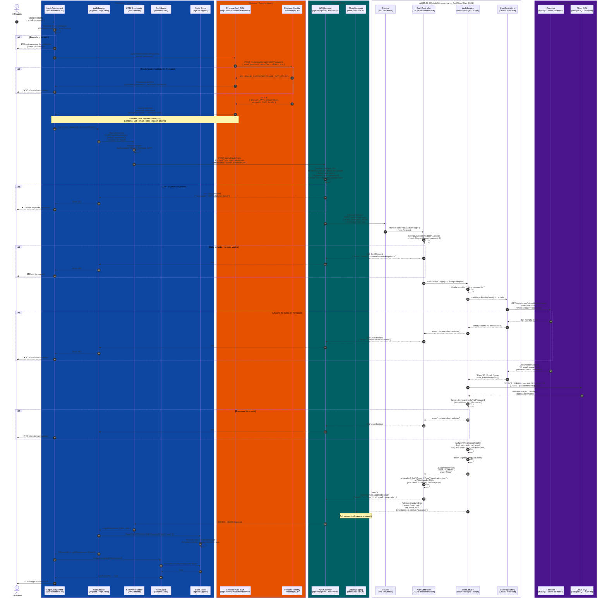

# Diagrama de Secuencia — Flujo de Login
> Sistema Informático Buen Vivir · Firebase Auth · Firestore · Go MVC · Google Cloud API Gateway

---

## Resumen del flujo por fases

| # | Fase | Actor principal | Protocolo / Formato |
|---|------|----------------|---------------------|
| 1 | Validación de form | `LoginComponent` | Reactive Forms (Angular) |
| 2 | Autenticación Firebase | `Firebase Auth SDK → Firebase IdP` | HTTPS · REST · JSON |
| 3 | Llamada al backend | `AuthService → HTTP Interceptor` | HttpClient · Bearer JWT |
| 4 | Validación JWT | `API Gateway` | RS256 · JWKS Google |
| 5 | Routing HTTP | `http.ServeMux → AuthController` | Go net/http |
| 6 | Lectura de usuario | `UserRepository → Firestore` | Firestore SDK · Document |
| 6b | Perfil extendido | `UserRepository → Cloud SQL` | GORM · SQL parameterizado |
| 7 | Verificación password | `AuthService` | bcrypt + JWT signing (RS256) |
| 8 | Respuesta JSON | `AuthController → API Gateway` | `200 OK` · `encoding/json` |
| 9 | Audit log | `AuthService → Cloud Logging` | Pub/Sub async · JSON structured |
| 10 | Persistencia de estado | `Store (NgRx / Signals)` | localStorage · in-memory |
| 11 | Navegación | `Router → AuthGuard` | Angular Router |

---

## Flujos alternos cubiertos

> [!WARNING]
> **Credenciales inválidas en Firebase** → `FirebaseAuthError` → UI error inline. No llega al backend.

> [!WARNING]
> **JWT inválido/expirado en API Gateway** → `401` antes de tocar el microservicio Go.

> [!WARNING]
> **Usuario no existe en Firestore** → `UserRepository` devuelve error → `401` desde `AuthController`.

> [!WARNING]
> **Password incorrecto (bcrypt)** → `AuthService` devuelve error → `401` desde `AuthController`.

> [!NOTE]
> El audit log a **Cloud Logging** es **asíncrono** — no bloquea el path crítico de respuesta al usuario.
