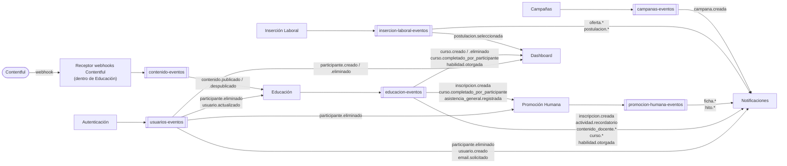

# Mensajería asíncrona (GCP Pub/Sub)

Referencia de los eventos entre servicios del sistema Buen Vivir: quién
publica qué, quién lo consume, con qué formato, y cómo se garantiza que
no se pierdan ni se procesen dos veces.

> **En una frase:** cuando pasa algo importante en un servicio (alguien se
> inscribe, entrega una actividad, se carga un hito), ese servicio deja un
> "aviso" (evento) en Pub/Sub. Los servicios interesados reciben el aviso
> y actualizan lo suyo, sin que el primero tenga que llamarlos ni esperar.

- Especificación formal: [`asyncapi.yaml`](asyncapi.yaml) (AsyncAPI 3.0)
- Decisiones: [`../adr/`](../adr/)
- Infraestructura: [`../../infra/pubsub/setup.sh`](../../infra/pubsub/setup.sh) (GCP) y
  [`emulator.sh`](../../infra/pubsub/emulator.sh) (local)
- Código común: [`../../pkg/events`](../../pkg/events) y [`../../pkg/outbox`](../../pkg/outbox),
  copiados en cada servicio con [`scripts/sync-eventlib.sh`](../../scripts/sync-eventlib.sh)

---

## 1. Mapa: productores → topics → consumidores



Todos los servicios productores publican eventos de dominio usando el patrón Outbox (Postgres en Auth, Firestore en Educación, Promoción Humana, Inserción Laboral y Campañas).

## 2. Topics

| Topic | Lo publica | Lo consumen | DLQ |
|---|---|---|---|
| `usuarios-eventos` ("Cascada de cambios de usuarios") | Autenticación | Educación, Promoción Humana, Dashboard, Notificaciones | `usuarios-eventos-dlq` |
| `educacion-eventos` | Educación | Promoción Humana, Dashboard, Notificaciones | `educacion-eventos-dlq` |
| `promocion-humana-eventos` | Promoción Humana | Notificaciones | `promocion-humana-eventos-dlq` |
| `contenido-eventos` ("Cola de eventos de contenido") | Receptor de webhooks de Contentful | Educación | `contenido-eventos-dlq` |
| `insercion-laboral-eventos` | Inserción Laboral | Dashboard, Notificaciones | `insercion-laboral-eventos-dlq` |
| `campanas-eventos` | Campañas | Notificaciones | `campanas-eventos-dlq` |

El único topic que ya existía es `rxresume-sync-topic` (cola interna de
rxresume). No se tocó, ver la sección 6.

### Suscripciones

Cada consumidor tiene **su propia suscripción push**, filtrada por el
atributo `event_type`. Solo le llegan los eventos que procesa.

| Suscripción | Topic | Endpoint | Recibe |
|---|---|---|---|
| `educacion-usuarios` | usuarios-eventos | `education /eventos/usuarios` | participante.eliminado, usuario.actualizado |
| `educacion-contenido` | contenido-eventos | `education /eventos/contenido` | contenido.publicado, contenido.despublicado |
| `promocion-humana-educacion` | educacion-eventos | `human-promotion /eventos/educacion` | inscripcion.creada, curso.completado_por_participante, asistencia_general.registrada |
| `promocion-humana-usuarios` | usuarios-eventos | `human-promotion /eventos/usuarios` | participante.eliminado |
| `dashboard-usuarios` | usuarios-eventos | `dashboard /eventos` | participante.creado, participante.eliminado |
| `dashboard-educacion` | educacion-eventos | `dashboard /eventos` | curso.creado, curso.eliminado, curso.completado_por_participante, habilidad.otorgada |
| `dashboard-insercion-laboral` | insercion-laboral-eventos | `dashboard /eventos` | postulacion.seleccionada |
| `notificaciones-educacion` | educacion-eventos | `notifications /eventos/educacion` | actividad.recordatorio, contenido_docente.moderado, contenido_docente.subido, curso.completado_por_participante, curso.creado, curso.eliminado, habilidad.otorgada, inscripcion.creada |
| `notificaciones-promocion-humana` | promocion-humana-eventos | `notifications /eventos/promocion-humana` | ficha.actualizada, ficha.creada, hito.actualizado, hito.registrado |
| `notificaciones-usuarios` | usuarios-eventos | `notifications /eventos/usuarios` | email.solicitado, participante.eliminado, usuario.creado |
| `notificaciones-insercion-laboral` | insercion-laboral-eventos | `notifications /eventos/insercion-laboral` | oferta.creada, oferta.revisada, postulacion.creada, postulacion.decidida |
| `notificaciones-campanas` | campanas-eventos | `notifications /eventos/campanas` | campana.creada |

Un test de cada servicio (`TestFiltrosDeInfraCoincidenConLosConsumidores`)
lee `infra/pubsub/setup.sh` y falla si el filtro no coincide con lo que
procesa el consumidor.

## 3. Formato del evento (envelope)

Todos los eventos nuevos usan el mismo sobre:

```json
{
  "event_id": "8f0c5a3e-2b1d-4c6e-9a7f-0d1e2f3a4b5c",
  "event_type": "educacion.inscripcion.creada",
  "version": 1,
  "occurred_at": "2026-10-16T18:30:00.000Z",
  "producer": "servicio-educacion",
  "correlation_id": "4e2a9c1b-7d3f-4a8e-b5c6-1f2e3d4c5b6a",
  "actor_id": "usr-123",
  "payload": { "inscripcion_id": "abc", "curso_id": "c1", "participante_id": "part-9", "fecha_inscripcion": "2026-10-16T18:30:00Z" }
}
```

- `event_type` sigue la forma `<dominio>.<entidad>.<acción>` y viaja también
  como **atributo** del mensaje, junto con `version`, `producer` y
  `correlation_id`. Así se puede filtrar sin leer el cuerpo.
- `occurred_at` va en RFC 3339 y UTC.
- `actor_id` es el usuario que originó la acción (sale del JWT). Queda
  vacío si no hubo usuario, por ejemplo en un webhook de Contentful.
- `correlation_id` viene del header `X-Correlation-ID` (o se genera uno).
  Se propaga a los eventos que publica un consumidor al procesar otro, así
  se sigue una operación de punta a punta en Cloud Logging.

### Regla de datos sensibles (Ley 25.326, RNF-06, RNF-08)

Los payloads llevan **solo ids y metadatos**. Nunca nombres, DNI,
teléfono, email, texto libre (observaciones, textos de entregas) ni el
contenido de una ficha o de un hito. Si un consumidor necesita un dato
personal, se lo pide por gRPC/HTTP al servicio dueño. Hay tests que
verifican que esos datos no aparezcan en los payloads (`producers_test.go`,
`repositories/events_test.go`).

## 4. Catálogo de eventos

Estado: **existente** = ya se publica; **nuevo** = implementado en esta
tarea; **pendiente** = falta coordinarlo con quien mantiene ese servicio.

| event_type | Productor | Consumidores | HU | Payload | Estado |
|---|---|---|---|---|---|
| `usuarios.usuario.creado` | Autenticación | Notificaciones | HU-01, HU-02 | `user_id`, `role_id`, `requires_verification`, `requires_approval` | nuevo |
| `usuarios.email.solicitado` | Autenticación | Notificaciones | HU-04, HU-06 | `user_id`, `email_type` | nuevo |
| `usuarios.participante.creado` | Autenticación | Dashboard | HU-52 | `participante_id`, `user_id` | nuevo |
| `usuarios.participante.eliminado` | Autenticación | Educación, Promoción Humana, Dashboard, Notificaciones | HU-09, HU-16 | `participante_id`, `user_id` | nuevo |
| `usuarios.usuario.actualizado` | Autenticación | Educación | HU-09 | `user_id`, `role_id`, `participante_id?`, `status`, `approval_status?` | nuevo |
| `insercion_laboral.oferta.creada` | Inserción Laboral | Notificaciones | HU-38 | `oferta_id`, `titulo`, `empresa_id` | nuevo |
| `insercion_laboral.oferta.revisada` | Inserción Laboral | Notificaciones | HU-39 | `oferta_id`, `estado`, `observaciones` | nuevo |
| `insercion_laboral.postulacion.creada` | Inserción Laboral | Notificaciones | HU-41 | `postulacion_id`, `oferta_id`, `participante_id` | nuevo |
| `insercion_laboral.postulacion.decidida` | Inserción Laboral | Notificaciones | HU-42 | `postulacion_id`, `oferta_id`, `participante_id`, `estado`, `observaciones` | nuevo |
| `insercion_laboral.postulacion.seleccionada` | Inserción Laboral | Dashboard | HU-52 | `postulacion_id`, `oferta_id`, `participante_id`, `empresa_id` | nuevo |
| `campanas.campana.creada` | Campañas | Notificaciones | HU-48 | `campana_id`, `titulo`, `tipo_campana`, `creada_por` | nuevo |
| `educacion.curso.creado` | Educación | Dashboard | HU-14 | `curso_id`, `area_formativa_id`, `docente_id`, `modalidad` | nuevo |
| `educacion.curso.actualizado` | Educación | — | HU-15 | ídem | nuevo |
| `educacion.curso.eliminado` | Educación | Dashboard | HU-16 | `curso_id` | nuevo |
| `educacion.inscripcion.creada` | Educación | Promoción Humana, Notificaciones *(futuro)* | HU-18, HU-26, HU-60 | `inscripcion_id`, `curso_id`, `participante_id`, `fecha_inscripcion` | nuevo |
| `educacion.asistencia.registrada` | Educación | — (recálculo de progreso) | HU-19, HU-20 | `asistencia_id`, `actividad_id`, `curso_id`, `participante_id`, `fecha`, `presente` | nuevo |
| `educacion.curso.completado_por_participante` | Educación | Promoción Humana, Dashboard | HU-20, HU-33 | `curso_id`, `participante_id`, `completado_en` | nuevo |
| `educacion.habilidad.otorgada` | Educación | Dashboard | HU-21, HU-58 | `habilidad_id`, `participante_id`, `actividad_id`, `curso_id`, `origen`, `fecha` | nuevo (reemplaza a `habilidad.aceptada`, ver supuestos) |
| `educacion.asistencia_general.registrada` | Educación | Promoción Humana | HU-19bis | `asistencia_id`, `participante_id`, `fecha` (AAAA-MM-DD), `presente` | nuevo |
| `educacion.asistencia_general.actualizada` | Educación | — | HU-19bis | ídem | nuevo |
| `educacion.contenido_docente.subido` | Educación | Notificaciones *(futuro)* | HU-23 | `docente_id`, `tipo` ("curso" con `curso_id` o "material" con `contenido_id`) | nuevo |
| `educacion.contenido_docente.moderado` | Educación | Notificaciones *(futuro)* | HU-23 | `resultado` ("aprobado" o "rechazado"); curso: `curso_id`; material: `contenido_id`, `docente_id`, `tipo` | nuevo |
| `promocion_humana.ficha.creada` | Promoción Humana | — | HU-29 | `ficha_id`, `participante_id` | nuevo |
| `promocion_humana.ficha.actualizada` | Promoción Humana | — | HU-30 | ídem | nuevo |
| `promocion_humana.hito.registrado` | Promoción Humana | — | HU-32 | `hito_id`, `ficha_id`, `participante_id`, `fecha`, `visible_participante` | nuevo |
| `promocion_humana.hito.actualizado` | Promoción Humana | — | HU-32 (edición pedida por el cliente) | ídem | nuevo |
| `contenido.publicado` | Receptor Contentful | Educación | HU-17 | `entry_id`, `content_type`, `environment`, `accion`, `revision?` | nuevo |
| `contenido.despublicado` | Receptor Contentful | Educación | HU-17 | ídem | nuevo |

Los structs Go de cada payload están en `pkg/events/catalog.go`. Todos
están en `version: 1`.

### Notificaciones (implementado)

Notificaciones consume eventos mediante 5 suscripciones push con OIDC:
- `notificaciones-educacion` sobre `educacion-eventos` (`/eventos/educacion`).
- `notificaciones-promocion-humana` sobre `promocion-humana-eventos` (`/eventos/promocion-humana`).
- `notificaciones-usuarios` sobre `usuarios-eventos` (`/eventos/usuarios`).
- `notificaciones-insercion-laboral` sobre `insercion-laboral-eventos` (`/eventos/insercion-laboral`).
- `notificaciones-campanas` sobre `campanas-eventos` (`/eventos/campanas`).

Reglas aplicadas:
- **`inscripcion.creada`**: confirmación de inscripción al participante y aviso al docente (HU-18, HU-26, HU-60).
- **`actividad.recordatorio`**: recordatorio de actividad próxima a participantes inscriptos (HU-26).
- **`contenido_docente.subido`**: aviso a administradores para revisión (HU-23).
- **`contenido_docente.moderado`**: aviso al docente con el resultado de aprobación/rechazo (HU-23).
- **`curso.completado_por_participante`**: felicitación al participante y aviso al docente.
- **`habilidad.otorgada`**: notificación de logro al participante.
- **`curso.creado` / `curso.eliminado`**: avisos a administradores y docentes.
- **`ficha.creada` / `ficha.actualizada`**: aviso a administradores y voluntarios responsables.
- **`hito.registrado` / `hito.actualizado`**: aviso a administradores y responsable del hito (prioritario si el hito es crítico).
- **`participante.eliminado`**: alerta de archivo/baja a administradores y voluntarios.
- **`usuario.creado`**: email de verificación de cuenta y aviso a administradores si requiere aprobación manual (HU-01, HU-02).
- **`email.solicitado`**: despacho de emails transaccionales de seguridad (recuperación de contraseña, reenvío de verificación o aprobación de cuenta) (HU-04, HU-06).
- **`oferta.creada`**: aviso a administradores para moderación de ofertas laborales (HU-38).
- **`oferta.revisada`**: notificación a la empresa postulante con la decisión (HU-39).
- **`postulacion.creada`**: aviso a la empresa ante una nueva postulación (HU-41).
- **`postulacion.decidida`**: notificación al participante sobre el resultado de su postulación (HU-42).
- **`campana.creada`**: difusión y alerta a administradores y voluntarios (HU-48).

**Seguridad y enlaces de acción:** Los eventos de dominio **no contienen tokens de seguridad ni links con credenciales** (cumpliendo ADR 0007). Cuando Notificaciones procesa un evento transaccional (`usuario.creado`, `email.solicitado`), solicita a demanda el enlace de acción seguro al microservicio `auth` vía gRPC (`IssueActionLink`), garantizando que ningún token viaje por Pub/Sub, registros de logs ni DLQs.

**Eliminación de deuda técnica HTTP:** El endpoint legado `POST /api/v1/notifications/send` y el middleware de firmas HMAC compartidas han sido **completamente eliminados**. Todos los disparadores de notificación del sistema son 100% asíncronos y desacoplados a través de Pub/Sub y el patrón Outbox.

El servicio aplica idempotencia en Postgres (`eventos_procesados`), resolución de destinatarios por roles (`GetActiveUserIDsByRoles`) o participante (`GetParticipant`) vía gRPC hacia Autenticación, persist-first atómico y despacho en segundo plano (`Worker`) con reintentos exponenciales y DLQ (`delivery_status = 'dead'`).

## 5. Autenticación, Inserción Laboral y Campañas: integración con Outbox

Todos los servicios publican sus eventos de dominio mediante el patrón Outbox transaccional garantizando no pérdida ante caídas de infraestructura:

| Evento | Servicio | Dónde se publica | Payload |
|---|---|---|---|
| `usuarios.usuario.creado` | Autenticación | `auth/internal/services/user_service.go`, `Register` | `{"user_id","role_id","requires_verification","requires_approval"}` |
| `usuarios.email.solicitado` | Autenticación | `auth/internal/services/verification_service.go`, `password_recovery_service.go` | `{"user_id","email_type"}` |
| `usuarios.participante.creado` | Autenticación | `auth/internal/services/participant_service.go`, `CreateParticipant`, tras crear el participante | `{"participante_id","user_id"}` |
| `usuarios.participante.eliminado` | Autenticación | `participant_service.go`, `DeleteParticipant`, y `user_service.go`, `DeleteUser` cuando el usuario es participante | `{"participante_id","user_id"}` |
| `usuarios.usuario.actualizado` | Autenticación | `user_service.go`, `UpdateUser`, y `participant_service.go`, `UpdateParticipant`, cuando cambia `status` o `approval_status` | `{"user_id","role_id","participante_id","status","approval_status"}` |
| `insercion_laboral.oferta.creada` | Inserción Laboral | `labor-integration/internal/services/job_offer_service.go`, `CreateOffer` | `{"oferta_id","titulo","empresa_id"}` |
| `insercion_laboral.oferta.revisada` | Inserción Laboral | `labor-integration/internal/services/job_offer_service.go`, `ApproveOffer`, `RejectOffer` | `{"oferta_id","estado","observaciones"}` |
| `insercion_laboral.postulacion.creada` | Inserción Laboral | `labor-integration/internal/services/job_application_service.go`, `ApplyToJob` | `{"postulacion_id","oferta_id","participante_id"}` |
| `insercion_laboral.postulacion.decidida` | Inserción Laboral | `labor-integration/internal/services/job_application_service.go`, `UpdateStatus` | `{"postulacion_id","oferta_id","participante_id","estado","observaciones"}` |
| `insercion_laboral.postulacion.seleccionada` | Inserción Laboral | `labor-integration/internal/services/job_application_service.go`, `UpdateStatus`, cuando el estado nuevo es "aceptado"/"seleccionado"/"contratado" (para Dashboard) | `{"postulacion_id","oferta_id","participante_id","empresa_id"}` |
| `campanas.campana.creada` | Campañas | `campaigns/internal/services/campaign_service.go`, `Create` | `{"campana_id","titulo","tipo_campana","creada_por"}` |

Cómo se publican sin perder eventos:

- **Autenticación (Postgres/GORM)** utiliza la tabla `outbox_events` escrita en la misma transacción que las entidades de dominio, y un worker en segundo plano (`OutboxWorker`) que publica en `usuarios-eventos` con `cloud.google.com/go/pubsub/v2`.
- **Inserción Laboral (Firestore)** utiliza `internal/outbox` (`Writer` en la colección `outbox_eventos` y `Relay` en segundo plano) publicando en `insercion-laboral-eventos`.
- **Campañas (MongoDB)** utiliza la colección `outbox_eventos` dentro de transacciones de MongoDB con un worker en segundo plano (`Worker`) publicando en `campanas-eventos`.
- Los topics `usuarios-eventos`, `insercion-laboral-eventos` y `campanas-eventos` están provisionados en `infra/pubsub/setup.sh` y `infra/pubsub/emulator.sh`.

## 6. Diferencias de formato con lo que ya existía

El único uso previo de Pub/Sub es **rxresume** (`rxresume/internal/worker/pubsub_queue.go`):

| | rxresume-sync-topic | Envelope estándar |
|---|---|---|
| Uso | cola de trabajo interna (el mismo servicio publica y consume) | evento de dominio entre servicios |
| Cuerpo | `{"user_id": "..."}` | envelope completo (sección 3) |
| Atributos | ninguno | `event_type`, `version`, `producer`, `correlation_id` |
| Id / idempotencia | sin id; reprocesar es idempotente porque re-sincroniza el CV | `event_id` + registro de procesados |
| Entrega | pull, `Receive` en una goroutine | push con OIDC (Cloud Run en scale to zero) |
| DLQ / reintentos | Nack + reintentos sin tope, sin DLQ | 5 intentos con backoff, después la DLQ |
| Topic | lo crea el propio servicio al arrancar | lo crea `infra/pubsub/setup.sh` |

**Propuesta (no aplicada, a consultar):** dejar `rxresume-sync-topic`
como está. Es una cola de trabajo y no un evento de dominio, y nadie más
la consume. Si en algún momento otro servicio necesita enterarse de que
un CV cambió, sería mejor publicar `curriculum.cv.actualizado` con el
envelope estándar en un topic propio. Mejoras opcionales para la cola
actual: agregarle DLQ y `max-delivery-attempts`, para que un CV que
siempre falla no se reintente para siempre. Ver
[ADR 0005](../adr/0005-formato-unico-de-eventos.md).

## 7. Cómo funciona por dentro

### Outbox: el evento no se pierde

```
request → [transacción Firestore: cambio + evento en outbox_eventos] → respuesta
                                         │
                        Relay (en segundo plano) ──publica──▶ Pub/Sub
                                         │
                       confirmado → se borra del outbox
                       falló      → se reintenta con backoff (5s, 10s, 20s… hasta 10 min)
```

- El cambio y el evento se escriben en **la misma transacción**. O quedan
  los dos, o ninguno. Si Pub/Sub está caído, el evento espera en
  `outbox_eventos` y se publica cuando vuelve.
- **Cursos**: viven en Contentful, que no comparte transacción con
  Firestore. El evento se escribe apenas Contentful confirma el cambio.
  Si esa escritura falla, el curso ya quedó creado: se registra el error
  en el log con el `correlation_id` y el request no falla. Es el único
  caso sin garantía total. Contentful igual emite su webhook, que genera
  `contenido.publicado` para las publicaciones.
- **Cloud Run escala a cero**: entre requests la instancia no tiene CPU,
  así que el Relay en segundo plano puede quedar parado. Por eso hay un
  job de Cloud Scheduler por minuto que llama a
  `POST /internal/outbox/flush` (con OIDC) en Educación y Promoción
  Humana. Ningún evento espera más de ~1 minuto.
- Si dos instancias barren a la vez, cada evento queda **reservado**
  (lease de 1 minuto) por la que lo tomó. Si una instancia se cae a mitad
  de camino, el evento se vuelve a publicar: el consumidor lo descarta
  como duplicado.

### Idempotencia: procesar dos veces = procesar una vez

Pub/Sub entrega "al menos una vez": el mismo mensaje puede llegar
repetido. Hay dos defensas:

1. **Registro de procesados.** Antes de procesar, el consumidor busca
   `eventos_procesados/{consumidor}_{event_id}`. Si existe, responde 204
   y no hace nada. Las marcas vencen a los 30 días (TTL de Firestore
   sobre `expira_en`). Dashboard, que no tiene base de datos, lo hace en
   memoria.
2. **Handlers idempotentes.** Por si el proceso se corta entre el efecto
   y la marca, cada handler deja el mismo estado aunque corra dos veces:
   la línea de tiempo usa `event_id` como id del documento, la baja de
   inscripciones solo toca las activas, invalidar una caché es
   inofensivo, etc.

Los webhooks de Contentful generan un `event_id` **determinístico**
(UUID v5 de entry + acción + revisión). Si Contentful reintenta el mismo
webhook, el outbox lo descarta en origen.

### Push, reintentos y DLQ

- Suscripciones **push** (no pull): con scale to zero no hay un proceso
  escuchando. Pub/Sub hace el POST y Cloud Run levanta la instancia.
  Ver [ADR 0002](../adr/0002-push-con-oidc.md).
- Cada push trae un **token OIDC** firmado por Google, emitido para una
  service account dedicada por consumidor. El servicio verifica firma,
  issuer, audience, vencimiento y que la cuenta esté en
  `PUBSUB_PUSH_SERVICE_ACCOUNTS` (`events.OIDCVerifier`, solo stdlib).
  Un push sin token válido recibe 401.
- Respuestas del consumidor:

  | Respuesta | Cuándo | Qué hace Pub/Sub |
  |---|---|---|
  | 204 | procesado, duplicado, o tipo/versión que no conoce | confirma |
  | 400 | mensaje malformado | reintenta y termina en la DLQ (para inspección) |
  | 401 | token inválido | reintenta |
  | 500 | falló el handler (por ejemplo, Firestore caído) | reintenta con backoff |

- Reintentos con backoff exponencial de 10 s a 10 min y ack deadline de
  30 s. **Después de 5 intentos** el mensaje va a `<topic>-dlq`, y se lo
  puede revisar con la suscripción `<topic>-dlq-revision`.

### Orden (ordering key)

Los eventos donde el orden importa (inscripción, asistencia, curso
completado, habilidad, fichas e hitos) se publican con
`ordering key = participante_id`. Las suscripciones de la línea de tiempo
tienen `enable-message-ordering`. Si falla un evento de un participante,
el Relay también posterga los siguientes de ese mismo participante, para
que no se adelanten. Igual, la línea de tiempo se ordena por la fecha del
hecho y no por el orden de llegada.

### Versionado

`version` empieza en 1. Un cambio **incompatible** del payload (sacar o
renombrar un campo, cambiar su tipo) obliga a subir la versión en
`currentVersions` (`pkg/events/catalog.go`) y en `asyncapi.yaml`. Agregar
un campo opcional no es incompatible. Un consumidor que recibe una
versión que no conoce la ignora (responde 204) y deja
`resultado=ignorado_version` en el log. Para migrar, el consumidor
registra el handler de la versión nueva antes de que el productor la
empiece a publicar.

### Logs

Todo queda en JSON en stdout, y de ahí a Cloud Logging, con `event_id`,
`event_type`, `correlation_id` y `resultado`:

- `procesado`, `duplicado`, `ignorado_tipo`, `ignorado_version`, `invalido`, `no_autorizado`, `error` (consumidores)
- `publicado`, `error`, `publicado_sin_borrar` (Relay)
- `encolado` (webhook)

Para seguir una operación: `jsonPayload.correlation_id="<id>"`.

## 8. Qué hace cada consumidor

- **Educación ← usuarios-eventos**: `participante.eliminado` pone las
  inscripciones **activas** del participante en `estado: "baja"`, con
  `motivo_baja: "participante_dado_de_baja"` y `fecha_baja`. No borra
  nada: entregas, asistencias y habilidades se conservan (HU-09, HU-16).
  `usuario.actualizado` hace lo mismo si la cuenta del participante dejó
  de estar `active`.
- **Educación ← contenido-eventos**: invalida la **caché de contenido**.
  Las lecturas de la Content Delivery API de Contentful se cachean 5
  minutos (`CONTENT_CACHE_TTL`). Si Contentful responde 5xx o no responde,
  se sirve la última versión válida, aunque esté vencida (HU-17, riesgo
  R2). Invalidar vence la caché pero conserva el respaldo. Cada escritura
  propia por la CMA también la invalida. Ver
  [ADR 0006](../adr/0006-cache-de-contenido.md).
- **Promoción Humana ← educacion-eventos**: agrega entradas a la colección
  `linea_tiempo` ("Se inscribió en un curso", "Completó un curso", "Asistió
  al centro"), sin números ni porcentajes. Solo la *presencia* en la
  asistencia general suma una entrada.
- **Promoción Humana ← usuarios-eventos**: `participante.eliminado` da de
  baja la ficha (`estado: "baja"`, `fecha_baja`). La ficha **no se borra**.
- **Dashboard ← los tres topics**: invalida en memoria la fuente afectada
  (participantes, cursos, habilidades o postulaciones). Dashboard sigue
  sin base de datos, ver [ADR 0003](../adr/0003-dashboard-sin-snapshots.md).

### Auditoría en Promoción Humana (HU-35, RNF-14)

Autenticación no tiene un mecanismo de auditoría (`LogAuditoria` no
existe), así que crear o actualizar una ficha o un hito, y la baja de una
ficha, escriben un registro en la colección `auditoria` de Promoción
Humana. Lleva usuario, acción, recurso, id, timestamp, IP y
correlation_id, y va **en la misma transacción** que el cambio. El
registro se escribe aunque Pub/Sub esté desactivado.

## 9. Configuración

| Variable | Servicios | Para qué |
|---|---|---|
| `PUBSUB_PROJECT_ID` | education, human-promotion | proyecto de GCP. Vacío = no publica (local) |
| `PUBSUB_TOPIC_EDUCACION`, `PUBSUB_TOPIC_CONTENIDO`, `PUBSUB_TOPIC_PROMOCION_HUMANA` | ídem | nombres de los topics (valores por defecto en la sección 2) |
| `PUBSUB_PUSH_AUDIENCE` | los tres | audience de los push: la URL del servicio (en Dashboard, `<url>/eventos`) |
| `PUBSUB_PUSH_SERVICE_ACCOUNTS` | los tres | service accounts autorizadas (las imprime `setup.sh`). Incluye la de Cloud Scheduler |
| `PUBSUB_PUSH_AUTH=disabled` | los tres | **solo local** con el emulador. En producción el servicio no arranca |
| `CONTENTFUL_WEBHOOK_SECRET` | education | secreto del header `X-Webhook-Secret` (Secret Manager) |
| `CONTENT_CACHE_TTL` | education | caché de Contentful (por defecto `5m`, `0` la desactiva) |
| `DASHBOARD_CACHE_TTL` | dashboard | caché de indicadores (por defecto `5m`) |
| `PUBSUB_EMULATOR_HOST` | todos | la librería de Pub/Sub usa el emulador si está seteada |

Sin estas variables, los servicios funcionan exactamente como antes: no
publican, no exponen `/eventos/*` y la auditoría de Promoción Humana se
escribe igual. El `docker-compose.yml` solo suma el emulador de Pub/Sub,
en el perfil `eventos`: sin ese perfil levanta lo mismo que antes.

### Puesta en marcha en GCP

1. `infra/pubsub/setup.sh` con las variables de su encabezado. Crea
   topics, DLQs, suscripciones, service accounts, IAM, el TTL de
   `eventos_procesados` y los jobs de Cloud Scheduler, y al final imprime
   las variables para Cloud Run.
2. Cargar esas variables en el deploy de cada servicio
   (`.github/workflows/pipeline.yml`) y `CONTENTFUL_WEBHOOK_SECRET` como
   secreto.
3. En Contentful (Settings → Webhooks): URL
   `https://<education>/webhooks/contentful`, topics *Entry: publish,
   unpublish, delete*, header secreto `X-Webhook-Secret`.

## 10. Correr en local

### Emuladores

```bash
# Firestore (sin Docker; Java 17+)
curl -sSL -o fs.jar https://storage.googleapis.com/firebase-preview-drop/emulator/cloud-firestore-emulator-v1.19.8.jar
java -jar fs.jar --host=127.0.0.1 --port=8390 &

# Pub/Sub: el del docker-compose, en el perfil "eventos" (localhost:8086).
docker compose --profile eventos up -d pubsub-emulator
# Sin Docker: gcloud beta emulators pubsub start --host-port=localhost:8086
```

### Tests

```bash
export FIRESTORE_EMULATOR_HOST=127.0.0.1:8390
export PUBSUB_EMULATOR_HOST=localhost:8086

(cd pkg && go test -cover ./...)               # librería canónica
(cd education && go test -cover ./...)         # incluye tests/integration
(cd human-promotion && go test -cover ./...)
(cd dashboard && go test -cover ./...)
scripts/sync-eventlib.sh --check               # las copias están al día
```

Sin emuladores, los tests que los necesitan se **saltean** (`t.Skip`) y
el resto corre igual. Los tests de integración
(`<servicio>/tests/integration`) recorren el camino completo: productor →
outbox → relay → Pub/Sub (con el filtro real) → handler push →
consumidor. El emulador no hace push autenticado, así que el test lee la
suscripción en pull y entrega cada mensaje al mismo handler HTTP.

| Flujo | Test |
|---|---|
| `inscripcion.creada` → Promoción Humana (línea de tiempo) | `human-promotion/tests/integration` · `TestInscripcionCreada_AgregaLineaDeTiempo` |
| webhook → `contenido.publicado` → invalidación de caché | `education/tests/integration` · `TestContenidoPublicado_InvalidaCache` |
| `participante.eliminado` → Educación | `education/tests/integration` · `TestParticipanteEliminado_DaDeBajaInscripciones` |
| `participante.eliminado` → Promoción Humana | `human-promotion/tests/integration` · `TestParticipanteEliminado_BajaLogicaDeFicha` |

Cobertura de la lógica de mensajería (RNF-18, mínimo 75%), medida el
2026-10-16 con ambos emuladores: Educación 94,3%, Promoción Humana
94,7%, Dashboard 96,6%, `pkg/events` 97,3%, `pkg/outbox` 88,2%.

### Probar a mano con los servicios corriendo

```bash
PUBSUB_EMULATOR_HOST=localhost:8086 infra/pubsub/emulator.sh   # topics + suscripciones push al emulador
# servicios con: PUBSUB_PROJECT_ID=ceibuenvivir PUBSUB_EMULATOR_HOST=localhost:8086 PUBSUB_PUSH_AUTH=disabled
```

Con el stack de Docker no hay que hacer nada: `docker compose up -d`
levanta `pubsub-emulator`, y `pubsub-init` corre `emulator.sh` con las
suscripciones apuntando a los contenedores. Education, human-promotion y
dashboard ya tienen esas variables y arrancan después de `pubsub-init`.
El emulador no guarda nada: si se recrea, `docker compose up -d` vuelve
a correr `pubsub-init`. Los eventos anteriores a prenderlo no se reenvían.

## 11. Cómo agregar un evento nuevo

1. **Definirlo** en `pkg/events/catalog.go`: la constante
   `<dominio>.<entidad>.<acción>` y el struct del payload, **solo con ids
   y metadatos**.
2. `scripts/sync-eventlib.sh` para copiarlo a los servicios.
3. **Publicarlo** desde el productor del servicio
   (`internal/events/producers`): un método que arme el payload desde el
   modelo. Llamarlo **dentro de la transacción** del repositorio
   (`AddTx`), después de las lecturas, y `Notify()` después del commit.
   Usar `participante_id` como ordering key si el orden importa.
4. **Consumirlo**: en `internal/events/consumers`, `c.Handle(tipo, 1, fn)`.
   El handler tiene que ser idempotente (id determinístico, "solo si
   todavía no está", etc.).
5. **Suscripción**: agregar el tipo al filtro en
   `infra/pubsub/setup.sh` y `emulator.sh`. Si la suscripción ya existe,
   borrarla y volver a crearla, porque el filtro no se puede cambiar. El
   test `TestFiltrosDeInfraCoincidenConLosConsumidores` avisa si te lo
   olvidás.
6. **Tests**: payload sin datos personales, handler (incluido el
   duplicado) y, si es un flujo nuevo, integración con el emulador.
7. **Documentar**: este README (tabla de la sección 4) y `asyncapi.yaml`.

## 12. Supuestos tomados (donde las HU eran ambiguas)

1. **Habilidades** (decisión del 2026-10-16): se respeta el modelo
   implementado el 2026-10-06. Las habilidades son por actividad, las
   sugiere la IA al armar la actividad y se ganan **al entregarla**.
   Entonces `curso.completado_por_participante` **no** dispara la IA, y
   en lugar de `habilidad.aceptada` (aprobación del admin) se publica
   `habilidad.otorgada` cuando el participante gana la habilidad.
2. **`curso.completado_por_participante`** = el participante entregó
   todas las actividades del curso. Se calcula en la transacción de la
   entrega. Si después se agregan actividades y las completa, se vuelve
   a emitir. Borrar actividades no lo dispara.
3. **`curso.eliminado`**: en Contentful el borrado es físico, no hay baja
   lógica del curso. El historial (inscripciones, entregas, asistencias)
   queda en Firestore.
4. **`contenido_docente.*`**: el "contenido docente" que existe hoy son
   los cursos que carga un docente en borrador. `subido` sale cuando un
   docente crea un curso. `moderado` con `resultado: "aprobado"` sale
   cuando la administración publica un curso, cualquiera sea su autor,
   porque el sistema no guarda quién lo creó. No existe un flujo de
   rechazo: `rechazado` queda reservado.
5. **`usuario.actualizado`**: Educación da de baja las inscripciones solo
   si la cuenta del participante dejó de estar `active`. Si la cuenta se
   reactiva, las inscripciones no vuelven solas: se lo vuelve a inscribir.
6. **Asistencia general**: solo la presencia genera entrada en la línea de
   tiempo. `registrada` = primera carga del día; `actualizada` = edición
   de una carga existente que cambió algo. La observación no viaja.
7. **`asistencia.registrada` y el progreso**: el progreso (HU-20) se
   calcula en el momento a partir de las entregas, así que no hace falta
   un consumidor que lo recalcule. El evento queda publicado para quien
   lo necesite.
8. **Línea de tiempo**: las entradas que llegan por eventos se guardan en
   `linea_tiempo` y se muestran **mezcladas por fecha con los hitos**, en
   "Mi proceso" (HU-34, dentro de `GET /mi-linea-de-tiempo`, campo
   `actividad`) y en la ficha (HU-33, `GET /fichas/{id}/actividad`). La
   asistencia al centro se agrupa en una entrada por mes ("Asistió al
   centro en septiembre de 2026"), sin contar días. El nombre del curso lo
   pone el frontend con el catálogo de Educación (decisión del 21/10).

## 13. Limitaciones conocidas

- La caché de contenido y la de Dashboard son **por instancia**. Un push
  invalida la instancia que lo recibe, y las demás se actualizan al vencer
  el TTL (5 min).
- Eventos de cursos: no son atómicos con Contentful (ver la sección 7).
- Firestore limita una transacción a 500 escrituras. Con eventos, la carga
  de asistencia general hace 2 escrituras por participante (registro +
  evento), así que el tope práctico es de ~250 participantes por fecha.
