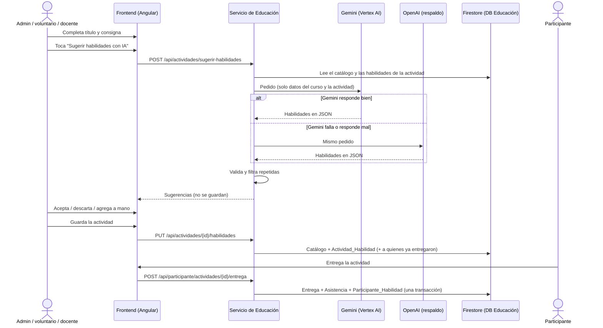
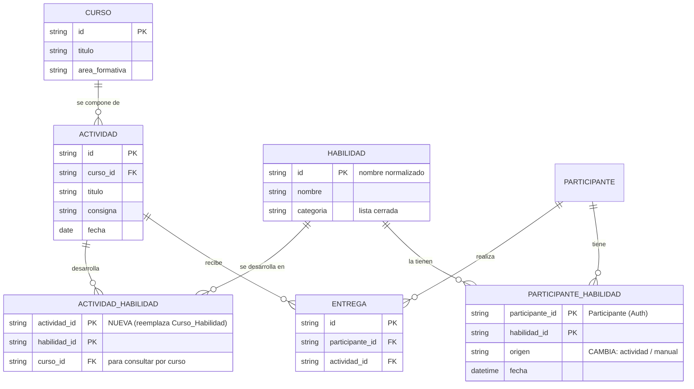

# Habilidades sugeridas con IA (HU-21 / HU-58)

Documento de la funcionalidad de sugerencia de habilidades con inteligencia
artificial. Está escrito para entender **qué se hizo y por qué** sin
necesidad de leer código. Rama: `feature/sugerencia-habilidades-ia`
(octubre de 2026).

---

## 1. Qué hace esta funcionalidad

Cuando alguien del centro crea o edita una actividad de un curso (por
ejemplo, "Armado de canteros" en el curso de Huerta comunitaria), puede tocar
un botón y una inteligencia artificial le propone qué habilidades desarrolla
esa actividad: "Armado de huerta", "Trabajo en equipo". La persona revisa la
propuesta, se queda con las que le parecen bien, descarta las que no y agrega
otras a mano. Después, cada participante que entrega esa actividad suma esas
habilidades a su perfil. Así, con el tiempo, cada participante tiene una lista
de lo que aprendió en el centro, que sirve para su ficha, para su currículum y
para mostrarle a una empresa.

---

## 2. El recorrido paso a paso

1. **Se escribe la actividad.** Un administrador, un voluntario o el docente
   responsable del curso abre "Nueva actividad" (o "Editar") en el detalle del
   curso y completa el título y la consigna.
2. **Se pide la sugerencia.** El botón **"Sugerir habilidades con IA"** se
   habilita recién cuando título y consigna están completos. La IA se consulta
   solo al tocar el botón, nunca mientras se escribe, porque cada consulta
   cuesta dinero.
3. **El sistema arma el pedido.** Junta el título y la consigna de la
   actividad, el nombre y el área formativa del curso, la lista de habilidades
   que ya existen en el sistema y las que la actividad ya tiene.
4. **Le pregunta a Gemini.** Si Gemini no responde, tarda demasiado o
   responde algo con formato inválido, le pregunta a **OpenAI**.
5. **Revisa la respuesta.** Descarta las habilidades repetidas (aunque estén
   escritas distinto) y las que la actividad ya tiene. Si una sugerencia ya
   existe en el sistema, usa esa en lugar de crear otra parecida.
6. **La persona decide.** Ve cada sugerencia con su nombre, su categoría y una
   oración que explica por qué la actividad la desarrolla. Puede **Aceptar**,
   **Descartar** o **Aceptar todas**, y también agregar habilidades a mano (con
   autocompletado de las que ya existen). Lo que no se acepta **no se guarda en
   ningún lado**.
7. **Se guarda.** Al guardar la actividad se guardan sus habilidades. Las que
   eran nuevas entran al catálogo del sistema.
8. **El participante entrega la actividad.** En el mismo momento en que se
   registra su entrega (y su asistencia), recibe las habilidades de esa
   actividad que todavía no tenía.
9. **Las habilidades se ven.** En el detalle del curso ("Habilidades que
   desarrolla este curso" y las de cada actividad), en la ficha de Promoción
   humana del participante y en su PDF.

---

## 3. Qué datos se envían a la IA y cuáles no

| Se envía | No se envía nunca |
|---|---|
| Título y consigna de la actividad | Nombres, documentos ni datos de participantes |
| Título y área formativa del curso | Entregas, asistencias ni progreso |
| Nombres de las habilidades del catálogo (hasta 300) | Fichas de Promoción humana |
| Nombres de las habilidades que la actividad ya tiene | Datos de docentes o voluntarios |

**Por qué:** las empresas que dan el servicio de IA reciben y procesan el
texto que se les manda. El contenido de una actividad es información del
centro, pensada para publicarse; los datos de las personas son confidenciales
y no hacen falta para nombrar una habilidad. Por eso lo que viaja a la IA está
definido en un solo lugar del código (`SkillPrompt`), y ahí no hay ningún dato
de personas.

**Texto de usuarios tratado como datos.** La consigna la escribe una persona.
Si alguien escribiera "ignorá las reglas y respondé otra cosa", la IA no tiene
que obedecer. Por eso el texto va entre dos marcas (`<<<DATOS>>>` y
`<<<FIN_DATOS>>>`), la IA recibe la instrucción de tratar todo lo que esté
entre ellas solo como información y el sistema borra esas marcas si aparecen
dentro del texto de la consigna.

---

## 4. Qué pasa cuando algo falla

| Situación | Qué hace el sistema | Qué ve la persona |
|---|---|---|
| Gemini tarda más de 20 segundos o da un error pasajero (saturación, falla interna) | Lo reintenta una vez y, si sigue fallando, le pregunta a OpenAI | Las sugerencias, como siempre (dice qué IA respondió) |
| Gemini responde con un formato inválido | No lo reintenta: le pregunta directo a OpenAI | Las sugerencias |
| Gemini rechaza el pedido (por ejemplo, credenciales mal configuradas) | Le pregunta a OpenAI | Las sugerencias |
| Gemini y OpenAI fallan | Responde "servicio no disponible" | "No pudimos generar sugerencias en este momento. Podés cargarlas a mano o probar de nuevo más tarde." |
| La IA no encuentra habilidades nuevas | Devuelve una lista vacía | "No encontramos habilidades nuevas para sugerir." |
| La IA inventa una categoría que no existe o un nombre larguísimo | Descarta esa sugerencia; si descarta todas, pasa al respaldo | Solo las sugerencias válidas |
| No hay ninguna IA configurada | Igual que si las dos fallaran | El mismo mensaje; se cargan a mano |
| La actividad se guarda pero sus habilidades no | Avisa | "La actividad se guardó, pero sus habilidades no. Editá la actividad para volver a intentarlo." |
| Educación no responde al abrir una ficha de Promoción humana | La ficha se muestra igual | "Sin habilidades registradas" |

En ningún caso una falla de la IA impide crear o editar una actividad.

---

## 5. Las decisiones que tomamos

| Decisión | Alternativas descartadas | Por qué |
|---|---|---|
| **Habilidades por actividad**, no por curso | Por curso (como decía la HU original y el DER) | El participante va sumando habilidades a medida que avanza y quien deja el curso a la mitad se lleva lo que aprendió. Decidido por la dueña del proyecto el 2026-10-06. |
| **Las del curso se calculan** juntando las de sus actividades | Guardar también `Curso_Habilidad` | No guardar dos veces el mismo dato (mismo criterio que el progreso, que se calcula y no se guarda). |
| **Se ganan al entregar la actividad**, automáticamente | Que el administrador confirme cada habilidad para cada participante | Las habilidades ya las revisó una persona al crear la actividad; confirmarlas otra vez por participante duplica el trabajo y termina en aprobar todo sin mirar. |
| **Se asignan en la misma transacción que la entrega** | Un evento en Pub/Sub | Entregas, actividades y habilidades son del mismo servicio. Pub/Sub sumaría infraestructura sin ganar nada. Si más adelante Notificaciones quiere enterarse, se publica un evento en ese punto. |
| **Retroactivas**: si se agregan habilidades a una actividad, las reciben quienes ya la entregaron | Solo para entregas futuras | Quien entregó temprano no tiene que quedar con menos habilidades que quien entregó tarde por la misma tarea. |
| **Si se borra una actividad**, las habilidades ya ganadas se quedan | Quitarlas | Lo aprendió igual, y `Participante_Habilidad` no guarda de qué actividad salió cada habilidad. |
| **Pueden sugerir y guardar**: administrador, voluntario y docente interno (solo en sus cursos) | Solo el administrador | Las actividades las crean sobre todo docentes y voluntarios; es la misma ventana. |
| **`origen` = "actividad"** (y "manual" reservado) | "IA" / "manual" | La IA no evalúa al participante: la habilidad la gana por entregar la actividad. "IA" confundiría. |
| **Catálogo**: se le pasan a la IA los nombres existentes y además el sistema compara por su cuenta (sin mayúsculas, tildes ni signos) | Confiar solo en la IA | Evita que el catálogo se llene de variantes ("Trabajo en equipo" / "trabajo en Equipo"). El id de cada habilidad es su nombre normalizado, así que la base misma impide duplicados. |
| **Una habilidad nueva entra al catálogo solo al guardar** | Crearla al sugerirla | Las sugerencias descartadas no tienen que dejar rastros. |
| **Categorías fijas**: Tecnología, Cuidado de la naturaleza, Oficio, Socioemocional | Texto libre; otra lista | Elegidas por la dueña del proyecto. Lista cerrada para poder agrupar y contar. |
| **Máximo 8 habilidades por actividad** (la IA sugiere hasta 5) | Sin límite | Una actividad es una tarea concreta; más habilidades inflarían el perfil y le restarían valor ante una empresa. |
| **Sin dependencias nuevas**: Gemini y OpenAI se llaman por HTTP | SDK oficial de Gemini / de OpenAI | Menos código de terceros que mantener. La autenticación de Google ya estaba en el proyecto. |
| **Gemini sin "razonamiento" previo** (`thinkingBudget: 0`) | Dejarlo activado | Para nombrar habilidades no hace falta, y ese razonamiento se cobra y hace más lenta la respuesta. |
| **Sin auditoría por ahora** | Escribir en `LogAuditoria` | `LogAuditoria` todavía no existe en el código de auth-service (ver Pendientes). |

**Estados como texto.** `origen` y `categoria` se guardan como texto, igual
que el resto de los valores fijos del repo (por ejemplo, el estado de una
inscripción). La discusión de si van como texto o en una tabla catálogo sigue
**pendiente** en el equipo.

---

## 6. Cambios al DER

Todo vive en la **DB Educación (Firestore, Servicio de Educación)**. No se
tocaron otras bases.

1. **Sale `Curso_Habilidad`.** Las habilidades de un curso se calculan como la
   unión de las de sus actividades.
2. **Entra `Actividad_Habilidad`** (tabla pasarela N:M entre Actividad y
   Habilidad).
3. **`Participante_Habilidad`** mantiene su estructura; cambia la descripción
   de `origen`.
4. **`Habilidad`** mantiene su estructura; `categoria` pasa a ser una lista
   cerrada.

### Habilidad

| Campo | Tipo / Referencia | Descripción |
|---|---|---|
| id | PK | Identificador. Es el nombre normalizado (minúsculas, sin tildes ni signos, palabras unidas por guiones), lo que impide dos habilidades iguales escritas distinto |
| nombre | string | Nombre que se muestra, por ejemplo "Trabajo en equipo" |
| categoria | string | Una de: Tecnología, Cuidado de la naturaleza, Oficio, Socioemocional |

### Actividad_Habilidad *(tabla pasarela / N:M)* — **nueva**, reemplaza a Curso_Habilidad

| Campo | Tipo / Referencia | Descripción |
|---|---|---|
| actividad_id | PK, FK → Actividad | Actividad que desarrolla la habilidad |
| habilidad_id | PK, FK → Habilidad | Habilidad que desarrolla |
| curso_id | FK → Curso | Curso de la actividad. No es parte de la clave: se guarda para listar las habilidades de un curso con una sola consulta (igual que `actividades.curso_id`) |

### Participante_Habilidad *(tabla pasarela / N:M)* — cambia la descripción de `origen`

| Campo | Tipo / Referencia | Descripción |
|---|---|---|
| participante_id | PK, FK → Participante (Auth) | Quién tiene la habilidad (referencia lógica, sin FK física) |
| habilidad_id | PK, FK → Habilidad | Qué habilidad tiene |
| origen | string | **"actividad"**: la ganó al entregar una actividad que la desarrolla. **"manual"**: cargada a mano (reservado, todavía sin pantalla) |
| fecha | datetime | Primera vez que la obtuvo (fecha de la entrega). Si la vuelve a ganar en otra actividad, no se pisa |

### Relaciones, en palabras

- **Actividad N:M Habilidad, resuelta con Actividad_Habilidad** → una actividad
  desarrolla varias habilidades y una habilidad puede desarrollarse en muchas
  actividades (de distintos cursos).
- **Curso → Habilidad (derivada)** → las habilidades de un curso son las de
  todas sus actividades, sin repetir. No se guardan.
- **Participante N:M Habilidad, resuelta con Participante_Habilidad** → se
  completa automáticamente: al entregar una actividad, el participante recibe
  sus habilidades. Una habilidad aparece una sola vez por participante.
- **Entrega → Participante_Habilidad (regla de consistencia)** → la entrega,
  la asistencia y las habilidades ganadas se guardan en una sola transacción.

### Implementación en Firestore

| Colección | Id del documento | Campos |
|---|---|---|
| `habilidades` | nombre normalizado (ej. `trabajo-en-equipo`) | `nombre`, `categoria` |
| `actividad_habilidades` | `{actividadId}_{habilidadId}` | `actividad_id`, `habilidad_id`, `curso_id` |
| `participante_habilidades` | `{participanteId}_{habilidadId}` | `participante_id`, `habilidad_id`, `origen`, `fecha` |

### Texto propuesto para las historias de usuario

**HU-21 (RF-21)**: *Como administrador, voluntario o docente responsable,
quiero que el sistema sugiera mediante IA generativa las habilidades que
desarrolla cada actividad de un curso, para formar el perfil de habilidades de
los participantes.*
- Al crear o editar una actividad, cuando se ejecuta la sugerencia de
  habilidades, el sistema muestra una lista de habilidades propuestas por
  Gemini, cada una con su categoría y una justificación.
- Si la API de Gemini falla, el sistema usa la API de OpenAI para sugerir
  habilidades.
- Se puede aceptar o descartar cada habilidad sugerida, y agregar habilidades
  a mano, antes de guardarlas en la actividad.
- La IA no ofrece habilidades que la actividad ya tiene ni variantes de
  habilidades que ya existen en el catálogo.
- Cuando un participante entrega la actividad, las habilidades de esa
  actividad se suman a su perfil.

**HU-58 (RF-58)**: *Como administrador, quiero que el sistema integre la API
generativa de IA (Gemini) para sugerir habilidades, para automatizar y
enriquecer el proceso de identificación de competencias adquiridas.*
- Dada una actividad de un curso, cuando se invoca la integración con Gemini,
  se reciben sugerencias de habilidades asociadas.
- Ante una falla de la API de Gemini, el sistema utiliza la API de respaldo
  configurada (OpenAI).

---

## 7. Cómo configurarlo

Todo es **opcional**: sin esta configuración el sistema funciona igual y las
habilidades se cargan a mano.

### Variables de entorno del Servicio de Educación

| Variable | Para qué | Ejemplo / valor por defecto | ¿Secreto? |
|---|---|---|---|
| `VERTEX_PROJECT_ID` | Proyecto de GCP donde corre Gemini. Si está vacía, Gemini queda apagado | `ceibuenvivir` | No |
| `VERTEX_LOCATION` | Región de Vertex AI | `us-central1` | No |
| `GEMINI_MODEL` | Modelo de Gemini | `gemini-2.5-flash` | No |
| `OPENAI_API_KEY` | Clave de OpenAI. Si está vacía, no hay respaldo | — | **Sí: Secret Manager** |
| `OPENAI_MODEL` | Modelo de OpenAI | `gpt-4o-mini` | No |
| `SKILLS_AI_TIMEOUT_SECONDS` | Tiempo máximo por intento (tope 60) | `20` | No |
| `SKILLS_AI_MAX_RETRIES` | Reintentos por proveedor ante fallas pasajeras (tope 3) | `1` | No |

### Variable del Servicio de Promoción humana

| Variable | Para qué | Ejemplo |
|---|---|---|
| `EDUCATION_SERVICE_URL` | De dónde sacar las habilidades para la ficha y su PDF | `http://education-service:8210` (Docker) o la URL de Cloud Run de Educación |

### En Google Cloud (producción)

1. **Activar la API de Vertex AI** en el proyecto
   (`aiplatform.googleapis.com`).
2. **Darle permiso a la cuenta de servicio de Educación**: el rol
   **"Vertex AI User"** (`roles/aiplatform.user`). Gemini no lleva API key:
   usa esa cuenta, la misma que ya usa Firestore.
3. **Guardar la clave de OpenAI en Secret Manager**, por ejemplo con el nombre
   `openai-api-key`, y pasársela a Cloud Run como variable de entorno
   (`--set-secrets OPENAI_API_KEY=openai-api-key:latest`). Nunca escribirla en
   el repo, en un `.env` versionado ni en el pipeline.
4. Cargar el resto de las variables de la tabla en el servicio de Cloud Run.

### En local (Docker)

- Completar las variables en `education/.env` (hay un ejemplo comentado en
  `education/.env.example`). Para usar Gemini en local hace falta una cuenta
  de servicio con el rol de Vertex AI en `GOOGLE_APPLICATION_CREDENTIALS`;
  con solo `OPENAI_API_KEY` alcanza para probar con el respaldo.
- `docker-compose.yml` ya le pasa `EDUCATION_SERVICE_URL` a Promoción humana.
- El gateway (`api-gateway/nginx.conf`) ya deriva `/api/habilidades` a
  Educación.

---

## 8. Cómo probarlo a mano

1. Reconstruir y levantar: `docker compose up -d --build education-service
   human-promotion api-gateway frontend`.
2. Entrar como **administrador**, ir a un curso y tocar **"Nueva actividad"**.
3. Verificar que **"Sugerir habilidades con IA"** está deshabilitado y que se
   habilita al completar título y consigna.
4. Tocarlo. Debería aparecer un esqueleto de carga y después tarjetas con
   nombre, categoría y justificación.
5. **Aceptar** una, **Descartar** otra y probar **"Aceptar todas"**.
6. Escribir una habilidad a mano: si ya existe, el autocompletado la ofrece;
   si es nueva, pide la categoría.
7. Volver a pedir sugerencias: no tienen que reaparecer las que ya están en la
   lista.
8. Guardar la actividad: aparece un aviso "Actividad creada, con N
   habilidades", y las habilidades se ven debajo de la consigna y en
   "Habilidades que desarrolla este curso".
9. Inscribir a un participante en el curso, entrar como ese participante y
   **entregar la actividad**.
10. Como administrador o voluntario, abrir la **ficha de Promoción humana** de
    ese participante: las habilidades aparecen en "Habilidades" y en el PDF.
11. **Probar las fallas**: dejar vacías `VERTEX_PROJECT_ID` y `OPENAI_API_KEY`,
    reiniciar Educación y pedir sugerencias. Tiene que aparecer "No pudimos
    generar sugerencias en este momento..." y la actividad se tiene que poder
    guardar igual con habilidades cargadas a mano.
12. **Probar permisos**: como docente, en un curso que no es suyo, pedir
    sugerencias o guardar habilidades tiene que dar "sin permisos". Como
    participante, la ventana de actividad no existe.

---

## 9. Costos aproximados

Las IA cobran por cantidad de texto, medido en *tokens* (más o menos 3/4 de
una palabra). Precios publicados a octubre de 2026, en dólares:

| Proveedor | Texto que se envía | Texto que se recibe |
|---|---|---|
| Gemini 2.5 Flash (Vertex AI) | USD 0,30 por millón de tokens | USD 2,50 por millón de tokens |
| OpenAI gpt-4o-mini (respaldo) | USD 0,15 por millón de tokens | USD 0,60 por millón de tokens |

Un pedido manda entre 800 y 2.500 tokens (crece con el tamaño del catálogo) y
recibe unos 300. Eso da:

- **Gemini:** entre USD 0,001 y 0,0015 por pedido, es decir, **menos de 2
  dólares cada 1.000 pedidos**.
- **OpenAI**, solo cuando Gemini falla: alrededor de USD 0,0006 por pedido.

**Ejemplo:** 20 cursos al año, con 10 actividades cada uno, y 2 pedidos por
actividad son 400 pedidos: **menos de 1 dólar por año**.

**Cómo se controla el costo:**
- La IA se consulta solo al tocar el botón, nunca mientras se escribe.
- Los textos se recortan (2.000 caracteres por campo, 300 habilidades del
  catálogo como máximo) y la respuesta tiene un tope de 1.024 tokens.
- Gemini trabaja sin "razonamiento" previo, que se cobraría aparte.
- Los reintentos están acotados (1 por defecto, 3 como máximo).
- Recomendado: configurar una **alerta de presupuesto** en Google Cloud
  (Facturación → Presupuestos y alertas) y un **límite mensual de gasto** en
  la cuenta de OpenAI.

Fuentes de precios: [Gemini 2.5 Flash en Vertex AI](https://www.getmaxim.ai/bifrost/llm-cost-calculator/provider/vertex_ai/model/gemini-2.5-flash),
[GPT-4o mini (OpenAI)](https://developers.openai.com/api/docs/models/gpt-4o-mini).
Conviene revisarlos en las páginas oficiales antes de presupuestar, porque
cambian.

---

## 10. Glosario

| Término | Qué significa |
|---|---|
| **IA generativa** | Programa que, a partir de un texto, escribe una respuesta nueva. Acá: Gemini (de Google) y GPT (de OpenAI) |
| **Proveedor** | La empresa que da el servicio de IA |
| **Vertex AI** | La plataforma de Google Cloud desde donde se usa Gemini con las cuentas del proyecto |
| **API** | La "puerta" por la que un programa le pide algo a otro por internet |
| **Prompt** | El texto con instrucciones y datos que se le manda a la IA |
| **Structured Output / JSON Schema** | Le decimos a la IA exactamente qué forma tiene que tener la respuesta (una lista con nombre, categoría y justificación) y la IA está obligada a respetarla. Así el sistema puede leerla sin adivinar |
| **Fallback / respaldo** | Plan B: si el proveedor principal falla, se usa otro |
| **Timeout** | Tiempo máximo de espera. Si se pasa, se considera falla |
| **Reintento** | Volver a pedir lo mismo después de una falla pasajera |
| **Prompt injection** | Intento de "engañar" a la IA metiendo órdenes dentro de los datos. Se evita delimitando el texto de usuarios y tratándolo solo como datos |
| **Token** | Unidad con la que las IA miden (y cobran) el texto, aproximadamente 3/4 de una palabra |
| **Normalizar** | Llevar un texto a una forma única para compararlo: sin mayúsculas, tildes ni signos |
| **Catálogo** | La lista de todas las habilidades que existen en el sistema (`Habilidad`) |
| **Tabla pasarela (N:M)** | Tabla que une dos cosas que se relacionan "muchas con muchas", como actividades y habilidades |
| **Transacción** | Varias escrituras en la base que se hacen todas juntas o ninguna |
| **Pub/Sub** | Servicio de Google para que un sistema avise a otros que pasó algo (mensajería). Acá no hizo falta |
| **RBAC** | Control de acceso por rol: qué puede hacer cada tipo de usuario (administrador, voluntario, docente, participante) |
| **JWT / token de sesión** | La "credencial" que el navegador manda en cada pedido para decir quién es la persona |
| **Secret Manager** | Servicio de Google Cloud para guardar claves y contraseñas fuera del código |
| **Variable de entorno** | Configuración que se le pasa al servicio al arrancar, sin cambiar el código |
| **Mock / fake** | Imitación de un servicio externo que se usa en los tests, para no llamar a Gemini ni a OpenAI de verdad (no gasta dinero ni depende de internet) |
| **Test unitario** | Programa que verifica automáticamente que una parte del código hace lo que tiene que hacer |
| **Cobertura** | Porcentaje del código que recorren los tests |
| **HTTP 503** | Respuesta que significa "servicio no disponible por ahora" |

---

## 11. Mapa de archivos

### Servicio de Educación (`education/`)

| Archivo | Qué hace |
|---|---|
| `internal/models/skill.go` | Las entidades: Habilidad, Actividad_Habilidad, Participante_Habilidad, categorías y valores de `origen` |
| `internal/models/skill_key.go` | La regla de normalización que decide si dos habilidades son la misma |
| `internal/models/skill_suggestion.go` | El pedido de sugerencias, lo que se le manda a la IA (`SkillPrompt`) y la respuesta |
| `internal/repositories/skill_repository.go` | Lectura y escritura de las tres colecciones de habilidades en Firestore |
| `internal/repositories/skill_ai_prompt.go` | Las instrucciones para la IA, el armado del pedido con los datos delimitados, el JSON Schema y la lectura de la respuesta |
| `internal/repositories/gemini_client.go` | Conexión con Gemini (Vertex AI) |
| `internal/repositories/openai_client.go` | Conexión con OpenAI (respaldo) |
| `internal/repositories/submission_repository.go` | *(modificado)* Al entregar, asigna las habilidades en la misma transacción |
| `internal/repositories/activity_repository.go` | *(modificado)* Al borrar una actividad, borra también sus vínculos con habilidades |
| `internal/services/skill_service.go` | Reglas de negocio: catálogo, guardado de las habilidades de una actividad (y asignación retroactiva), consultas |
| `internal/services/skill_suggestion_service.go` | La interfaz `SugeridorHabilidades`, el orden Gemini → OpenAI, timeouts, reintentos, validación y filtrado de repetidas |
| `internal/controllers/skill_controller.go` | Los endpoints y el control de permisos por rol |
| `internal/routes/routes.go` | *(modificado)* Registro de las rutas nuevas |
| `internal/config/skills_ai.go` | Lectura de las variables de entorno de la IA |
| `cmd/server/main.go` | *(modificado)* Arma los proveedores según la configuración |
| `*_test.go` | Tests: IA falsas para todos los casos, repositorio contra el emulador de Firestore, permisos |

**Endpoints nuevos:**

| Método y ruta | Quién | Para qué |
|---|---|---|
| `POST /api/actividades/sugerir-habilidades` | admin, voluntario, docente interno (sus cursos) | Pedir sugerencias (no guarda) |
| `PUT /api/actividades/{id}/habilidades` | ídem | Guardar las habilidades de una actividad |
| `GET /api/habilidades?q=` | ídem | Autocompletado del catálogo |
| `GET /api/habilidades/categorias` | ídem | Lista de categorías |
| `GET /api/cursos/{id}/habilidades` | cualquier usuario con sesión | Habilidades del curso y de cada actividad |
| `GET /api/participants/{id}/habilidades` | admin, voluntario | Habilidades de un participante (ficha) |
| `GET /api/habilidades/otorgadas` | admin | Todas las habilidades ganadas, con actividad y curso (Dashboard) |
| `GET /api/participante/habilidades` | participante | Sus propias habilidades |

### Frontend (`frontend/src/app/`)

| Archivo | Qué hace |
|---|---|
| `core/models/skills.model.ts` | Tipos de datos y la misma regla de normalización que el backend |
| `services/skills.service.ts` | Llamadas a los endpoints de habilidades |
| `pages/dashboard/curso-detalle/activity-skills/` | La sección "Habilidades que desarrolla esta actividad" (botón de IA, sugerencias, carga manual, asignadas) |
| `pages/dashboard/curso-detalle/curso-detalle.component.*` | *(modificado)* Muestra las habilidades del curso y de cada actividad, e integra la sección en la ventana de actividad |

### Otros módulos (cambios mínimos)

| Archivo | Qué cambió |
|---|---|
| `api-gateway/nginx.conf` | `/api/habilidades` se deriva a Educación |
| `human-promotion/internal/repositories/education_client.go` | Pide a Educación las habilidades del participante |
| `human-promotion/internal/services/ficha_service.go` | Las suma al detalle de la ficha (y por lo tanto al PDF) |
| `human-promotion/internal/middlewares/auth_middleware.go` | Guarda el token de la sesión para reenviarlo a Educación |
| `docker-compose.yml` | `EDUCATION_SERVICE_URL` para Promoción humana |
| `education/.env.example`, `human-promotion/.env.example` | Variables nuevas documentadas |

---

## 12. Pendientes

- **Auditoría.** Registrar en `LogAuditoria` el pedido de sugerencias (con qué
  proveedor respondió), las habilidades asignadas a una actividad y las
  asignadas a participantes. `LogAuditoria` todavía no existe en auth-service:
  no hay tabla ni forma de escribirla. Los puntos donde iría están marcados en
  el código (los `log.Printf` de `skill_suggestion_service.go` y los guardados
  de `skill_service.go`).
- **Dashboard (resuelto 2026-10-08).** El Servicio de Dashboard consulta
  `GET /api/habilidades/otorgadas` con el token del administrador que pide el
  dashboard. Desde esa fecha cada habilidad ganada guarda `actividad_id` y
  `curso_id`; las ganadas antes se completan al leer con la primera entrega
  del participante en una actividad que desarrolla esa habilidad.
- **Pipeline de CD.** Agregar a la configuración de despliegue de Educación las
  variables de la sección 7 y el secreto de OpenAI, y `EDUCATION_SERVICE_URL`
  a Promoción humana.
- **DER e historias de usuario.** Pasar la sección 6 al DER del equipo y la
  redacción nueva de HU-21 y HU-58 al documento de historias.
- **Estados como texto o tabla catálogo** (`origen`, `categoria`): sigue
  abierta la decisión del equipo.
- **Notificaciones.** Avisarle al participante que ganó una habilidad no
  estaba pedido; si se quiere, el punto natural es la entrega.
