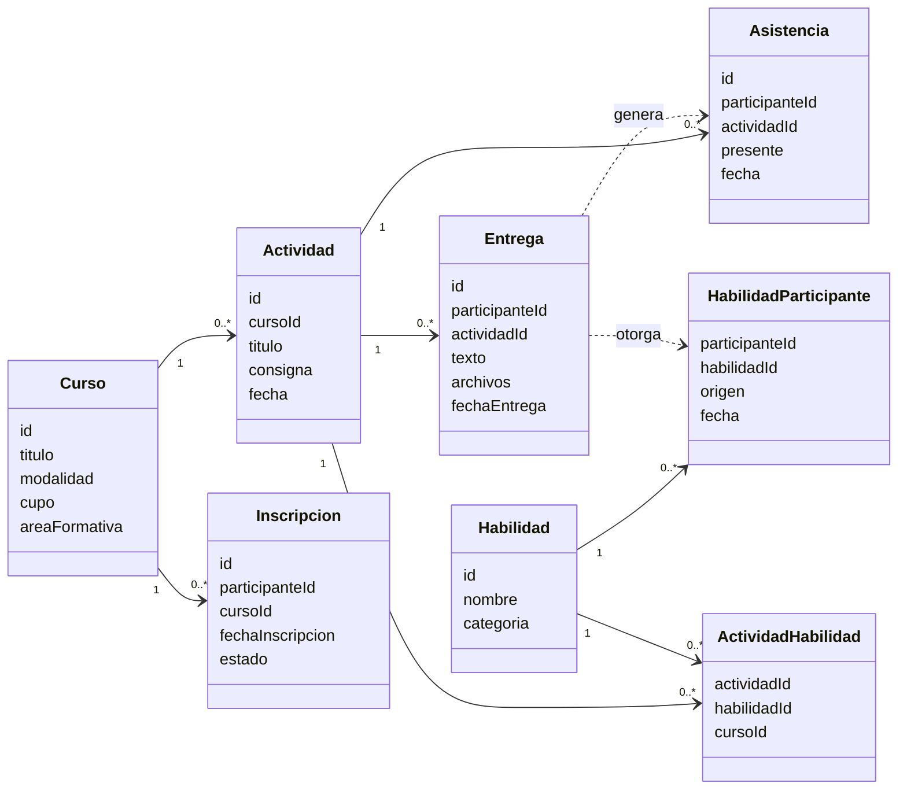
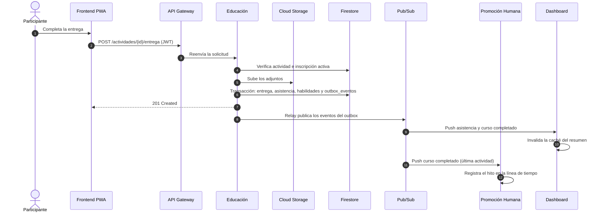

# Diagramas UML para el IPI (Figuras 35 y 36)

Código Mermaid verificado contra el código de `education/` (modelos y
`CreateWithAttendance` en `submission_repository.go`) y los consumidores de
`dashboard/` y `human-promotion/`.

Para obtener la imagen: pegar cada bloque en https://mermaid.live, exportar PNG e
insertarlo en el documento, en la sección "Comunicación entre módulos" (después de
la Figura 34), con número, título en cursiva, descripción y fuente.

## Figura 35. Diagrama de clases del dominio de Educación

Descripción sugerida: Entidades del servicio de Educación y sus relaciones. La
entrega de una actividad genera la asistencia y otorga las habilidades asociadas a
esa actividad. Fuente: elaboración propia.

## Figura 36. Diagrama de secuencia de la entrega de una actividad

Descripción sugerida: Flujo síncrono (REST) y asíncrono (Pub/Sub con Transactional
Outbox) desde que un participante entrega una actividad hasta que Dashboard y
Promoción Humana reciben los eventos. Fuente: elaboración propia.

